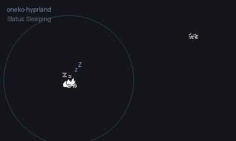

# oneko-hyprland 🐾

> A modernized, true-transparency port of the classic **oneko** desktop pet for **Wayland / Hyprland**, featuring native Hyprland IPC cursor tracking and distance-based proximity waking!

<p align="center">
  
</p>

<p align="center">
  <a href="#features"></a>
  <a href="#proximity-detection"></a>
  <a href="#transparency"></a>
  <a href="LICENSE"></a>
</p>

---

## 📖 Origin & Attribution

This project is directly derived from the classic X11 desktop pet **`oneko`**, originally created by **Masayuki Koba** (1990) and subsequently extended by **Tatsuya Kato**, **John Lerchey**, **Eric Anderson**, **Toshihiro Kanda**, and **Kiichiroh Mukose**.

On modern Wayland compositors (specifically **Hyprland**), legacy `oneko` suffered from three fatal issues:
1. **Frozen Cursor Tracking**: X11's `XQueryPointer` cannot track the mouse cursor across native Wayland applications (kitty, Firefox, Waybar, etc.), freezing the cat on the screen.
2. **Black Box Background Artifact**: Due to XWayland handling of 24-bit visuals, non-transparent bounding boxes and black shadow rectangles appeared around the cat sprite.
3. **Disappearing / Unpinned Windows**: The cat window would frequently drop underneath tiled windows or disappear when switching workspaces.

**`oneko-hyprland`** completely resolves these issues while introducing intelligent proximity awareness!

---

## ✨ Features & Enhancements

### 🚀 Hyprland UNIX Domain Socket IPC
- Instead of relying on restricted X11 pointer queries, `oneko-hyprland` connects directly to Hyprland's active UNIX socket (`/run/user/<uid>/hypr/$HYPRLAND_INSTANCE_SIGNATURE/.socket.sock`).
- Queries real-time global cursor coordinates (`cursorpos`) with sub-millisecond (~0.02ms) overhead.
- Flawlessly chases the mouse pointer anywhere across multi-monitor setups, native Wayland apps, and XWayland clients.

### 💎 True 32-bit ARGB Alpha Transparency
- Automatically selects a 32-bit `TrueColor` ARGB visual (`depth == 32`).
- Renders sprite frames with pure 32-bit alpha transparency (`0x00000000` transparent background, `0xFFxxxxxx` sprite fill).
- **100% elimination** of the notorious black box and shadow square artifact under XWayland.

### 💤 Proximity-Based Chasing (`-proximity <pixels>`)
- Euclidean distance calculation between the pet and your cursor:
  $$\text{distance} = \sqrt{(x_{\text{mouse}} - x_{\text{pet}})^2 + (y_{\text{mouse}} - y_{\text{pet}})^2}$$
- **Default radius**: `500` pixels.
- When the cursor is far away (> 500px), the cat comfortably sleeps (`Zzz...`) or grooms itself without cluttering your screen.
- When you move your cursor within the proximity boundary, the cat immediately perks up with an alert animation (`!`) and begins playfully chasing your mouse!
- Configurable to any distance (or set to `0` / high values to customize).

### 📌 Pinned & Non-Intrusive
- Window class explicitly set to `oneko` (`XClassHint`), allowing Hyprland window rules to pin the pet across all workspaces, float it above other windows, and disable focus-stealing or tiling interference.

---

## 🐾 Characters & Skins

`oneko-hyprland` includes all classic character skins and custom chasing cursors:

| Flag | Character | Description | Chase Object |
| :--- | :--- | :--- | :--- |
| *(default)* or `-neko` | **Classic Neko** | The original playful Japanese white cat | Mouse pointer |
| `-tora` | **Tora-Neko** | Playful tiger-striped cat | Mouse pointer |
| `-dog` | **Inu (Dog)** | Energetic puppy | Bone cursor 🦴 |
| `-bsd` or `-bsd_daemon` | **BSD Daemon** | Marshall Kirk McKusick's classic BSD Beastie | Trident cursor 🔱 |
| `-sakura` | **Sakura** | Sakura Kinomoto (*Cardcaptor Sakura*) | Clow Card 🃏 |
| `-tomoyo` | **Tomoyo** | Tomoyo Daidouji (*Cardcaptor Sakura*) | Cherry Blossom Petal 🌸 |

---

## 🛠️ Installation

### Dependencies

On **Arch Linux / EndeavourOS / Manjaro**:
```bash
sudo pacman -S base-devel libx11 libxext
```

### Build from Source

```bash
git clone https://github.com/akshaytiwary-dev/oneko-k.git
cd oneko-k
make
sudo make install
```

This installs the binary to `/usr/local/bin/oneko` and the man page to `/usr/local/share/man/man1/oneko.1`.

To install to your local user directory without `sudo`:
```bash
make PREFIX=$HOME/.local install
```

---

## ⚙️ Hyprland Configuration

To ensure `oneko` floats cleanly without borders, shadows, blur, or focus stealing, add the following rules to your Hyprland configuration (e.g. `~/.config/hypr/hyprland.conf` or `~/.config/hypr/configs/window_rules.conf`):

```ini
# oneko-hyprland window rules
windowrule = float true, match:class ^(oneko)$
windowrule = pin true, match:class ^(oneko)$
windowrule = no_shadow true, match:class ^(oneko)$
windowrule = no_blur true, match:class ^(oneko)$
windowrule = border_size 0, match:class ^(oneko)$
windowrule = decorate false, match:class ^(oneko)$
windowrule = rounding 0, match:class ^(oneko)$
windowrule = no_focus true, match:class ^(oneko)$
```

*A ready-to-use snippet is provided in [`hyprland/oneko.conf`](hyprland/oneko.conf).*

---

## 🚀 Usage & Command-Line Options

### Quick Start Examples

```bash
# Default cat with 500px proximity trigger (runs in background)
oneko &

# Tiger cat with custom 300px proximity radius
oneko -tora -proximity 300 &

# Playful dog chasing a bone with faster movement
oneko -dog -speed 20 &

# BSD Daemon chasing a trident with custom foreground color
oneko -bsd -fg "#ff5555" &

# Sakura Kinomoto chasing Clow Cards
oneko -sakura &

# Tomoyo Daidouji chasing cherry blossom petals
oneko -tomoyo &
```

### Full Command-Line Options Reference

| Option | Argument | Description | Default |
| :--- | :--- | :--- | :--- |
| `-proximity` | `<dots>` | Distance threshold in pixels to wake up and chase | `500` |
| `-speed` | `<dots>` | Distance pet moves per step | `16` |
| `-time` | `<microseconds>` | Animation update interval (smaller = faster) | `125000` |
| `-idle` | `<dots>` | Mouse speed required to trigger awake animation | `6` |
| `-fg` / `-foreground` | `<color>` | Color of pet outline/body | `black` |
| `-bg` / `-background` | `<color>` | Background tint (transparent by default in 32-bit mode) | `white` |
| `-rv` | *(none)* | Reverse video (inverts foreground/background) | Off |
| `-position` | `+X+Y` | Offset relative to mouse pointer | `+0+0` |
| `-name` | `<name>` | Set custom window name | `oneko` |
| `-help` / `-h` | *(none)* | Display help message and exit | — |

---

## 📂 Project Structure

```
oneko-hyprland/
├── assets/
│   └── demo.gif            # Preview animation of proximity chasing
├── bitmaps/                # 32x32 character sprite frames (XBM)
│   ├── bsd/                # BSD Daemon sprites
│   ├── dog/                # Dog sprites
│   ├── sakura/             # Sakura Kinomoto sprites
│   ├── tomoyo/             # Tomoyo Daidouji sprites
│   └── tora/               # Tiger-striped cat sprites
├── bitmasks/               # Transparency mask bitmaps
├── cursors/                # Custom cursors (mouse, bone, trident, card, petal)
├── hyprland/
│   └── oneko.conf          # Standalone Hyprland window rules snippet
├── src/
│   ├── oneko.c             # Main source code (Hyprland IPC + 32-bit ARGB + Proximity)
│   ├── oneko.h             # Headers and definitions
│   └── patchlevel.h        # Patch version header
├── .gitignore              # Ignored build artifacts
├── LICENSE                 # BSD 2-Clause / Public Domain license
├── Makefile                # Build and installation Makefile
├── oneko.1                 # Standard UNIX man page
└── README.md               # Documentation and usage guide
```

---

## 📜 License & Credits

- Original `xneko` by **Masayuki Koba** (1990).
- BSD Daemon Copyright © 1988 by **Marshall Kirk McKusick**.
- Sakura Kinomoto & Tomoyo Daidouji characters from *"CARDCAPTOR SAKURA"* (CLAMP, Kodansha).
- Hyprland IPC cursor tracking, 32-bit ARGB visual transparency, and proximity wake engine developed for modern Linux Wayland environments.
- Licensed under the **BSD 2-Clause License**. See [`LICENSE`](LICENSE) for details.
